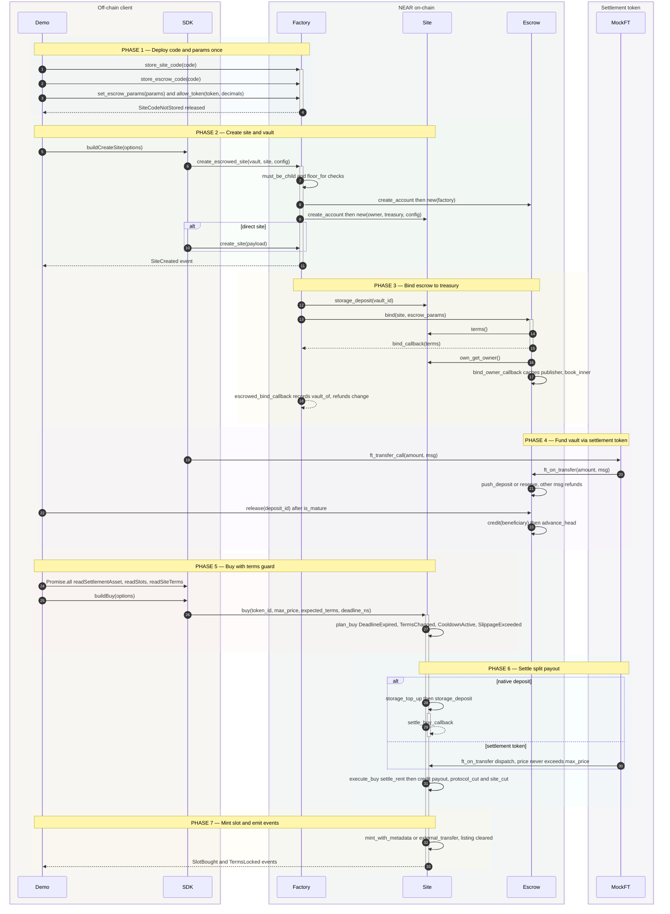

# stele

**NEP-171 slot NFTs + time-bounded function-call-key tenancy, NEP-141 settlement.**

A publisher divides a page into named slots. Each slot is a NEP-171 token. The holder can write the content behind the slot. The holder can also sell the slot on the site's own mean-reverting price curve. A holder can rent the slot for a fixed term. Tenancy is a time-bounded function-call access key. The tenant signs content writes with a session key scoped to the site contract and to `edit`. A function-call key carries no expiry of its own, so the contract asserts the rental window on every gated call. Settlement is NEP-141, and the native branch pays native NEAR. Payouts go through a pull ledger. Every site is its own account, with its own storage and its own frozen code.



## Quickstart
```bash
# 1. contracts (rustc 1.100.0, pinned by rust-toolchain.toml)
cargo check --workspace --target wasm32-unknown-unknown
cargo test -p stele-site --tests            # 38 tests
# 2. wasm artifacts
for c in site factory escrow mock-ft; do (cd contracts/$c && cargo near build non-reproducible-wasm); done
# 3. client (pnpm 12.18.0, Node >= 26.13.1)
pnpm install
pnpm -C packages/sdk typecheck
pnpm -C packages/react typecheck
pnpm -C packages/sdk build
pnpm -C packages/react build
pnpm exec vitest run packages/sdk/src
# 4. zero-funds dry-run (Linux/macOS; WSL2 on Windows)
STELE_SKIP_ESCROW=1 STELE_SKIP_EXPIRY=1 \
STELE_SITE_WASM=$PWD/target/near/stele_site/stele_site.wasm \
STELE_FACTORY_WASM=$PWD/target/near/stele_factory/stele_factory.wasm \
STELE_ESCROW_WASM=$PWD/target/near/stele_escrow/stele_escrow.wasm \
STELE_MOCK_FT_WASM=$PWD/target/near/stele_mock_ft/stele_mock_ft.wasm \
node scripts/sandbox-dry-run.mjs
```

## Numbers
Vectors: **3,024** take-price rows + **690** v2 ask/rent/fee rows, with a sha256 per file in `vectors/manifest.json`.

- Rust: parity 10 tests, terms/ratchet 26, view/encumbrance 2, 0 failed (`cargo test -p stele-site --test parity`, `cargo test -p stele-site --test terms`, `cargo test -p stele-site --test views`).
- SDK: 15 tests, 0 failed in `packages/sdk/src/stele.test.ts`.

Totals: **3,714 parity vector executions**, 38 Rust + 15 SDK tests, **0 failed**. Gas is not a headline claim; the sandbox prints a per-receipt `gas_burnt`.

Release wasm sizes come from `cargo near build non-reproducible-wasm`. The ABI is embedded, `opt-level = "z"`, and factory/escrow/mock-ft are `cdylib`-only:

| Artifact | Bytes |
|---|---|
| site | 428,124 |
| factory | 183,047 |
| escrow | 179,537 |
| mock-ft | 125,535 |

## Layout
- `near-stele` monorepo: `contracts/{site,factory,escrow,mock-ft}`, `tests/sandbox`, `scripts/{regen-vectors-from-origin.sh,sandbox-dry-run.mjs}`, `rust-toolchain.toml`, `.nvmrc`, `pnpm-workspace.yaml`.
- `packages/{sdk,react}`, `apps/demo`, `vectors/{price-vectors.jsonl,v2-vectors.jsonl,encumbrance-vectors.jsonl,manifest.json}`.

## Toolchain pins
- Rust 1.100.0, edition 2024 (`rust-toolchain.toml`); Node >= 26.13.1 (`.nvmrc`), pnpm 12.18.0, cargo-near 0.23.0, wasm-opt 0.116.1.
- near-sdk 5.30.2, near-sdk-contract-tools 4.0.0, primitive-types 0.14.0, near-api-js 7.5.3, near-sandbox 0.3.5.
- @hot-labs/near-connect 0.12.0, near-connect-hooks 1.1.6, typescript 7.0.2, tsx 4.23.15, tsup 9.0.0, vitest 5.1.0, next 16.4.6, react/react-dom 19.3.1, @types/node 26.6.6.

`pnpm-workspace.yaml` holds `autoDedupe`, `dedupePeers`, and `overrides`. The overrides keep exactly one `@hot-labs/near-connect` version in the lockfile. Lockfiles: `Cargo.lock` and `pnpm-lock.yaml`. `.env.example` carries `NEAR_FACTORY_ACCOUNT`, `NEAR_SITE_ACCOUNT`, `NEAR_VAULT_ACCOUNT`, `NEAR_FT_ACCOUNT`, and `NEAR_RPC_URL`: testnet example values, no keys.

## Limits
- Escrowed-site creation and timestamp-based expiry are descoped. `create_escrowed_site` fails in its vault/site XCC chain at receipt `i=3` with `Exceeded the prepaid gas` (12.808 TGas). The `+0.89 TGas` is fixed function-call and receipt-creation overhead. Attach at `allotment - 1 Tgas` instead of raising caps.
- `sandbox_fast_forward` moves height only, so block timestamps do not move. The post-expiry edit and `end_rental`/hash-restore assertions are unreachable in the harness. Patch `Rental.expiry`/`BlockInfo` instead of advancing height. The descoped dry-run (`STELE_SKIP_ESCROW=1 STELE_SKIP_EXPIRY=1`) ends `DRY-RUN OK`.
- The sandbox is Unix-only and runs zero-funds. No mainnet deployment is part of this repository.
- The factory supplies the site's `min_slot_floor` from the settlement asset's real decimals. Native 24 gives 1e20, and a 6-decimal mock FT gives 100. `new` never derives the floor from `ft_metadata`, because that call is asynchronous.
- Royalty info is display-only. `buy` never deducts it.

## Origin, license, hackathon
Port of an MIT-licensed EVM product. Provenance, baseline commit, and archive hash are in `ORIGIN.md`; the upstream notice is reproduced in `ATTRIBUTION.md`. The MIT license is kept.

Tracks: `realworld`, `business`. Submission checklist, payload fields, and deadline: `SUBMISSION-PREP.md`.
