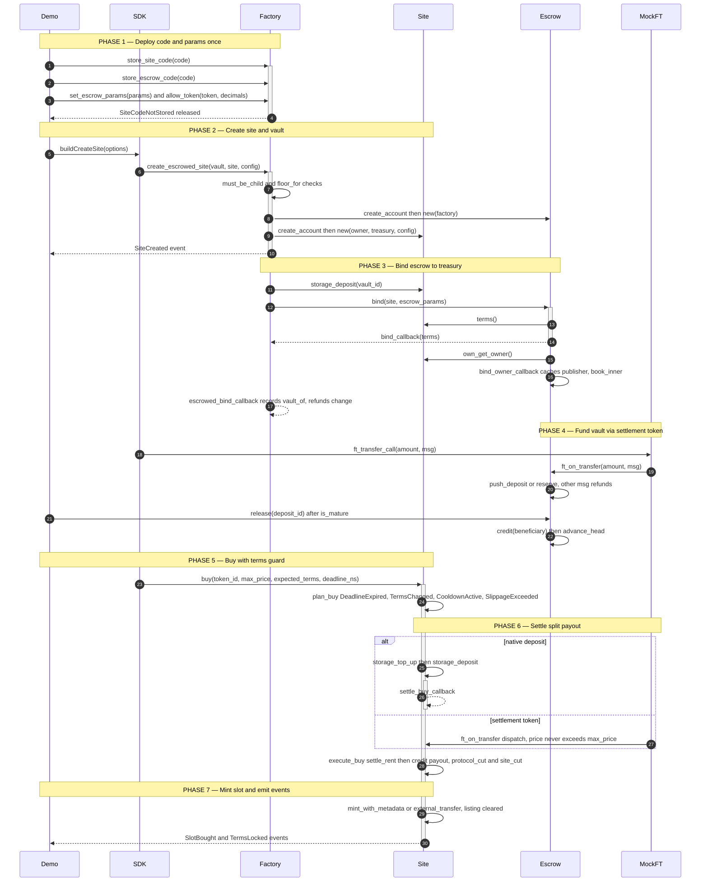

# stele

**Tracks:** `nfts`, `realworld` · **Licence:** MIT · **NEP:** NEP-171 / NEP-141 · **Baseline:** tag `pre-hackathon` marks the imported tree at `30779ef` (upstream `vibecodermaxi/websitekit`), diff `git diff pre-hackathon..hackathon-submission` · **Q-015 sibling:** **skjold** (agent identity and credentials, tracks `security`, `agents`).

Slot NFTs that do something: each NEP-171 token is a site slot with a price curve and a pull-payment ledger. Buys are guarded by deadline, terms, cooldown and slippage; terms only tighten; sellers withdraw from escrow credit. Tenancy expiry is descoped.



```bash
cargo check --workspace --target wasm32-unknown-unknown
cargo test -p stele-site --tests
for c in site factory escrow mock-ft; do (cd contracts/$c && cargo near build non-reproducible-wasm); done
pnpm install
pnpm -C packages/sdk typecheck && pnpm -C packages/react typecheck
pnpm -C packages/sdk build && pnpm -C packages/react build
pnpm exec vitest run packages/sdk/src
STELE_SKIP_ESCROW=1 STELE_SKIP_EXPIRY=1 node scripts/sandbox-dry-run.mjs
```

| Do this | See this | Proves |
|---|---|---|
| run the quickstart block above | clean builds | quickstart |
| `cargo test -p stele-site --tests` | 38 tests pass | tests |
| `pnpm exec vitest run packages/sdk/src` | 15 tests pass | SDK tested |
| `vectors/manifest.json` | 3,714 vector executions | price curve parity |
| buy guards (`plan_buy`) | DeadlineExpired/TermsChanged/CooldownActive/SlippageExceeded | guards are tested |
| `node scripts/sandbox-dry-run.mjs` | `DRY-RUN OK` | smoke/measure |
| `git diff pre-hackathon..hackathon-submission`; `git rev-parse --short hackathon-submission` | tag `pre-hackathon` at `30779ef` | baseline |
| descoped dry-run | escrowed-site creation and timestamp-based expiry are descoped | Limits: `create_escrowed_site` fails at i=3 with `Exceeded the prepaid gas` (12.808 TGas); royalties are display-only |

Links: [ATTRIBUTION](ATTRIBUTION.md) · [LICENSE](LICENSE).
